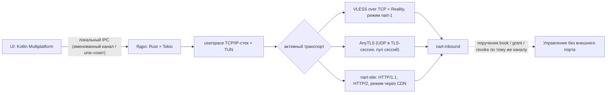

# Nart

Собственное VPN-решение: клиентская и серверная части на Rust (Tokio),
интерфейс на Kotlin Multiplatform. Свой сетевой путь — от сборки ClientHello
до userspace-стека в туннеле.

Проект закрытый: исходный код не публикуется. Этот репозиторий — описание
архитектуры и результатов измерений. Готов показать работающий прототип,
клиенты и тесты на личной технической демонстрации.

Статус: рабочий прототип с живым сервером и клиентами на трёх платформах.
Не публичный продукт.

## Архитектура

- Ядро — единый Rust-крейт: TLS 1.3 и REALITY собственными модулями
  (включая сборку ClientHello по образцу Chrome и AES-GCM на AES-NI/CLMUL),
  транспортный слой, локальный SOCKS5, userspace TCP/IP-стек (smoltcp)
  для туннеля.
- UI не линкует ядро: общение только по локальному IPC (именованный канал
  на Windows, unix-сокет на Linux и Android).
- Сервер — тот же код, другой бинарник (`nart-inbound`).
- Управление сервером — через собственный контролируемый канал внутри
  уже открытой двери, без стороннего управляющего порта.

## Транспортные режимы

| Режим | Что это | Статус |
|---|---|---|
| VLESS over TCP + Reality | Протокол известный (Xray, sing-box); реализация клиента и сервера — наша, пустой flow | в поставке |
| nart-1 | Наш режим внутри VLESS: записи приложения режутся до 64 байт, несколько TCP идут кадрами по одному соединению, переезд на новый TCP по порогу объёма (`switch_after`) | в поставке |
| AnyTLS | Протокол sing-box (версия 2); наша реализация клиента и сервера, UDP внутри TLS-сессии, пул сессий, сверка сертификата по ключу листа | в поставке |
| nart-site | Наш транспорт поверх HTTP/1.1 и HTTP/2: снаружи обычные запросы к сайту-прикрытию (GET формы, multipart POST), внутри — туннель; HTTP/2 с Reality, открытый HTTP/2, клиентский режим через CDN | в поставке |
| MASQUE (CONNECT-UDP / CONNECT-IP) | Реализован за feature-флагом, сверен с masque-go и connect-ip-go; в обычные и Android-сборки не входит | экспериментально |

В поставку не входят: Hysteria2, TUIC, Trojan, Shadowsocks, VMess,
WireGuard, XHTTP.

## Маршрутизация и выбор соединения

- Решение «туннель или обычная сеть» принимается по имени из DNS-ответа
  и спискам сетей; имя не из списка идёт обычной сетью.
- Исключение отдельных приложений из туннеля на Android (в том числе по
  префиксу имени пакета).
- Смена Wi-Fi/сотовой сети на Android: интерфейс остаётся, соединение
  пересобирается без переустановки VPN (проверено в обе стороны).
- Несколько серверов: клиент переводит новые соединения на вариант,
  который стабильно отвечает быстрее; уже открытые остаются на
  первоначальном. Ручной выбор отключает проверку.
- Переключение транспорта при признаках блокировки (failover).

## Доступ: ключ устройства вместо UUID

- Приложение само создаёт ключ устройства (32 байта); сервер сверяет
  открытый ключ — одной скопированной ссылки недостаточно.
- Закрытая половина ключа издателя и приватный ключ сервера остаются
  у оператора, в ссылку подключения не входят.
- Набор подписывается; чужое или неподписанное тело набор не подменяет.
- Учёт мест: потолок аппаратов на одном доступе задаёт оператор.

## Сравнительные испытания (14 октября 2026)

С Nart сравнивались официальные сборки sing-box 1.14.1 и Xray 26.3.27.
Сценарий: VLESS over TCP + Reality, пустой flow, без мультиплексирования.

**Условия.** Клиент на Windows 10 (Ryzen 3 4300GE, 16 ГБ), сервер в WSL2
той же машины (4 vCPU, 6 ГБ). Нагрузка через локальный SOCKS, адаптер
TUN не поднимался. Десять повторов по 60 с на режим, порядок сторон
сдвигается. ClientHello каждой стороны подогнан под профиль Chrome
(побайтовое совпадение отпечатков не проверялось). Измеритель — одна и та
же программа для прямого канала и обоих туннелей; iperf3 не использовался.
Прямой канал без туннеля: медиана скачивания 8351,2 Мбит/с.

**Правило зачёта.** Результат засчитывается, если худший из десяти
повторов Nart лучше лучшего повтора и sing-box, и Xray. Сравнение одних
медиан зачётом не считается.

**Зачтённые результаты TCP** (медиана и диапазон десяти повторов, Мбит/с):

| Измерение | Nart | sing-box 1.14.1 | Xray 26.3.27 |
|---|---:|---:|---:|
| Скачивание, 1 поток | **4164,4** (4067,1–4353,0) | 3653,8 (3556,1–3743,2) | 2936,6 (2710,1–2954,4) |
| Отдача, 4 потока | **3909,5** (3786,6–4059,9) | 3346,5 (3262,8–3566,5) | 3010,5 (2928,7–3092,9) |

В двух остальных TCP-режимах медиана тоже у Nart, но диапазоны
повторов пересекаются — эти строки не зачёт.

**Память на всех измерениях TCP** (пик резидентной памяти, МиБ):

| | Nart | sing-box | Xray |
|---|---:|---:|---:|
| Клиент | **13,9** | 38,8 | 27,2 |
| Сервер | **6,8** | 62,2 | 37,7 |

По процессору на одном потоке стороны идут вровень; на отдаче в четыре
потока Nart берёт больше ядер (2,36 в среднем, пик 3,00).

**UDP и задержка — зависят от сценария.** Потери UDP на 1200 байт:
ниже Xray по всему диапазону на 48 Мбит/с и ниже sing-box на 96 и
172,8 Мбит/с; на 172,8 Мбит/с медиана потерь ниже у Xray. По задержке
зачёта нет: без нагрузки медианы Nart ниже (0,83 мс p50 против 0,93
у обеих сторон), под нагрузкой диапазоны пересекаются; хвост p95 на
одном потоке скачивания короче у Nart (3,31 против 5,17 и 7,46).
Холодное подключение: 285/315 мс (медиана/p95), диапазоны пересекаются,
отдельной разницы нет.

Отдельный замер вне этого стенда: на домашней линии с ограничением
250 Мбит/с телефон через туннель выбрал линию целиком; sing-box и Xray
в нём не участвовали.

**Ограничения выводов.** Результаты получены в локальной связке
Windows + WSL2. Они не заменяют испытаний на удалённом сервере, на
телефоне и в сетях абонентов и ничего не доказывают про устойчивость
к блокировкам, поведение DNS и надёжность длительных соединений.
Полный протокол: условия, таблицы, сырые прогоны — по запросу.

## Nart Control

Управляющая платформа, в активной разработке. Не завершённый продукт.

Уже есть (с тестами): локальный слушатель только на 127.0.0.1, две роли
(оператор/аудитор), постоянный журнал, фазы модулей, Config Studio
(черновик, проверка, публикация записи на стол), люди и ключи устройств,
поручения столу (book/grant/revoke с номерами и дописыванием), канал
Telegram (проверка токена, приём событий, отправка в показанный чат,
человек из личного чата), балансировщик в единственном ручном режиме,
коммерция без провайдера (вебхук HMAC — приём подписи, не платёж),
задачи, копия каталога, PostgreSQL-хранение с книгой миграций.

Ещё нет: доставка конфигурации на узел, платежи, терминал, обновления,
расписание копий. Панель поднимается без стола; живая связь со столом —
по трём маршрутам на 127.0.0.1.

## Зрелость проекта

Nart — рабочий прототип, а не публичный продукт. Перед раздачей набора
широкому кругу абонентов в дорожной карте стоят два пункта: усиление
модели первоначального доверия к подписи конфигурации и переход службы
учёта устройств на защищённый транспорт. Остальные известные границы
отмечены в блоке об ограничениях измерений выше.

## Контакты

Исходный код закрыт. Готов обсудить трудоустройство, контрактную
разработку или техническое сотрудничество и провести демонстрацию
клиентов, ядра, архитектуры и тестов.

Почта: Project-Nart@proton.me

Последняя правка: 26 октября 2026.
